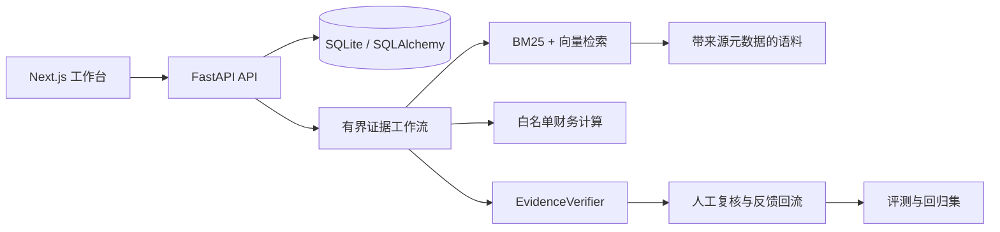

# FinSentinel v0.1 架构

The v0.1 system uses a FastAPI service, SQLite, a Next.js workbench, deterministic financial tools, BM25 evidence retrieval and a bounded workflow. LangGraph and model providers are adapters added after the deterministic path is tested.

Data flow: official-source metadata and local documents enter the ingestion boundary; parsed pages and metrics enter the relational store; tools return typed values and evidence IDs; the workflow records every node and tool call; the frontend displays citations and review state.

## 边界

- `synthetic_demo` 只用于接口和页面联调，数字、公司、页码和证据均为合成数据。
- `real_corpus` 需要本地准备公开来源材料；仓库不提交原始 PDF、完整提取文本、索引或向量库。
- 工作流在证据不足、期间不匹配或工具参数错误时应停止或降级为待人工复核。
- 系统是研究辅助工具，不提供投资建议、交易信号或收益承诺。
