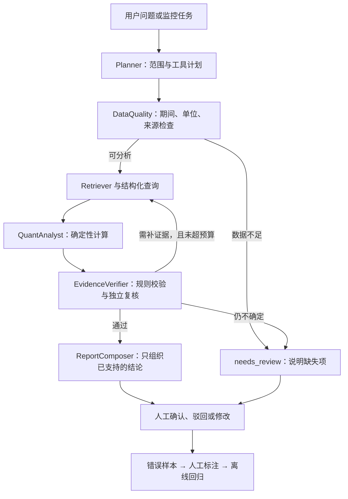

# FinSentinel：开源项目规划与学习路线

版本：1.0 · 日期：2026-11-04

**项目负责人：你。前端、后端、数据库、部署与 GitHub 开源均由你亲自完成。本文是实施指南，不是已完成项目的说明，也不代表任何功能或性能指标已通过验收。**

## 1. 项目目标与验收原则

FinSentinel 是面向研究员、风控人员和金融研究学习者的“消费电子财报与公告证据链风险研判工作台”。它帮助使用者完成：

> 跟踪一组公司 → 识别指标变化和公告事件 → 查阅原文证据 → 形成待复核解释 → 人工确认或纠正 → 用错误样本改进系统。

项目主线是 Agent 工程开发。金融分析提供真实问题，前后端和数据库承载完整业务，评测说明系统质量。简历最值得讲的不是接入了多少框架，而是你如何让分析结果可计算、可追溯、可复核，并用实验决定哪些设计有价值。

不能承诺“找不出毛病”。可追求的工程标准是：边界明确、主要风险有测试、失败可定位、结果可复现、已知限制公开。

### 1.1 一个完整的使用案例

用户选择一家公司及报告期间，提出“利润变化是否与经营现金流、存货变化一致”。系统展示：

1. 指标数值、单位、期间及同比或方向变化；
2. 每个数值的报表位置和计算公式；
3. 与变化相关的公告原文；
4. 明确区分的“已披露事实”“规则触发”“待验证解释”；
5. 复核结果及未能回答的问题；
6. 确认、驳回和修改入口。

“现金流下降”和“公司存在经营危机”不是同一结论。系统可以标记前者及其证据，不能仅凭一个指标断言后者。

### 1.2 首版不做什么

- 股价预测、交易执行、买卖建议、收益率承诺。
- 实时行情、全市场覆盖、完整企业知识图谱。
- 任意 Python/SQL 执行、自主修改代码或 Prompt、自主上线新版本。
- 复杂权限平台、计费、多租户和 Kubernetes。
- 让所有查询都经过多个 LLM 节点。

## 2. 范围、数据与实际需求验证

### 2.1 两个版本

| 版本 | 必须完成的内容 | 放行条件 |
|---|---|---|
| v0.1 | 5 家公司；10–15 份真实材料；年度指标；三类风险；一条完整分析与复核链路；SQLite、BM25、网页展示 | 数据可追溯，核心公式测试通过，无证据时不编造，人工可完成复核 |
| v0.2 | 累计扩展至 20–30 家公司、50–100 份材料；PostgreSQL、混合检索、异步任务、版本对比与优化实验 | v0.1 验收通过，并已有证据说明扩展功能解决了实际问题 |

16 周、每周 8–12 小时，合计约 128–192 小时。**16 周以 v0.1 完整闭环和开源交付为必达目标；v0.2 是通过前置验收后继续推进的扩展。** 若 React、SQL 和 Python Web 均从零学习，应延长时间，不以删掉验证环节换进度。

### 2.2 首批公司与语料

候选公司：立讯精密（002475）、歌尔股份（002241）、蓝思科技（300433）、领益智造（002600）、长盈精密（300115）。开始实施时核验证券代码、公司名称和行业分类。这五家公司覆盖不同业务，不能直接假定所有指标具有同业可比性。

建议首批材料固定为：

- 每家公司 2024、2025 年年度报告，共 10 份；利用年报内的上期比较数支持年度分析。
- 再选最多 5 份与减值、诉讼、客户集中或关联交易相关的真实公告，总计不超过 15 份。
- 如果候选材料不含某类风险事件，补充披露了该事件的文档，或明确该类暂缺样本；不能编造正例。
- 声称“三类风险均已验证”前，每类至少人工核验一个真实正例和一个不触发的对照；样本不足的类别只能标记未验证。
- 首版仅实现年度比较。季度、半年报、滚动十二个月和复杂重述链留给后续版本。

同业比较先按业务子组筛选，并在界面展示“可比性说明”；样本不足时只做公司自身跨期比较。

### 2.3 数据来源和使用方式

优先从巨潮资讯、交易所、上市公司官网取得公开披露材料。逐份记录来源 URL、披露日期、访问时间、SHA-256、报告期间和提取方式。公开可访问不等于允许任意再分发。

GitHub 默认发布代码、元数据清单、抓取脚本、人工编写的评测标注和必要的少量证据摘录。全文 PDF、完整提取文本、索引和向量库先不上传；有明确再分发依据后再决定发布范围。

数据必须分开：

| 数据类别 | 用途 | 约束 |
|---|---|---|
| synthetic fixture | 单元测试、离线演示、异常边界测试 | 使用虚构公司或醒目标记，不能形成真实金融结论 |
| real corpus | 实际研究与端到端验证 | 有来源、页码、期间、版本及质量状态 |
| eval dataset | 开发集与冻结测试集 | 人工回查原文，保留标注说明，不由系统自己的答案充当标准答案 |

### 2.4 用少量用户验证需求

第 1–2 周找 2–3 位金融课程同学、投资研究社团成员或有分析经验的人，观察他们完成一次“查数—找原因—核对出处”的过程。记录具体痛点、当前步骤、耗时和误差来源。第 13–15 周请他们用相似难度的新任务试用系统。

可比较复核耗时和找到证据的步骤数，必须记录参与人数与任务。便利样本只能说明可用性，不能声称已验证专业机构级需求。

## 3. 技术路线与技术栈分工

| 技术 | 在项目中的职责 | 引入时机 |
|---|---|---|
| Python 3.12+、FastAPI、Pydantic 2 | 服务接口、类型约束、输入校验 | 开始后端时 |
| SQLAlchemy 2、Alembic | 关系模型、事务、数据库版本迁移 | 第一次建表时 |
| SQLite | 本地开发、单实例 v0.1 | 从第一版使用 |
| PostgreSQL | 需要更可靠并发写入、部署和索引时 | v0.2 |
| BM25 | 词法检索基线 | 原文解析完成后 |
| pgvector、embedding 模型 | 语义检索，和词法结果融合 | 有检索失败样本后 |
| React、Next.js、TypeScript | 研究工作台与交互 | 尽早展示第一条真实证据，再逐步完善 |
| LangGraph | 有边界的状态图、条件分支和运行状态 | 普通函数流程能稳定运行后 |
| LangChain | 模型适配、结构化输出、工具封装 | 接入 LLM 时，按需使用 |
| Redis、Arq | 单后端技术路线下的异步任务和调度 | v0.2，确有后台任务需求时 |
| OpenTelemetry | 服务与工作流调用链；辅助定位延迟 | 基础运行日志完成后 |
| FastGPT | 可视化对照流程与学习实验 | 主系统和评测集稳定后 |

采用 Arq 作为计划中的任务队列，不同时学习 Celery。SQLite 与 PostgreSQL 使用同一业务接口，但迁移仍要实际验证 JSON、日期、数值、外键和事务行为，不能因为使用 ORM 就认为完全兼容。

先实现并验证普通函数，再接入框架；框架负责协作和连接，不替代财务公式与数据口径。

## 4. Workflow 与 Multi-agent 的真实边界

### 4.1 不把每个函数都称为 Agent

Workflow 是预先定义的流程；Agent 是能够在受限工具范围内选择下一步行动的角色。检索函数、指标计算函数和 JSON 校验器本身不是 Agent。

先完成确定性 Workflow，再引入两个职责独立的 Agent：

- **分析 Agent**：解析问题，选择白名单检索和分析工具，提出带证据的结构化结论；最多 6 次工具调用。
- **复核 Agent**：获得问题、结论和证据，独立检查证据支持程度，可追加只读检索；最多 3 次工具调用。只向分析 Agent 返回结构化问题清单，不接受对方的自我评价作为证据。

允许最多一轮“复核发现问题 → 分析 Agent 修订 → 再检查”。超出预算、证据不足或冲突未解决，转人工复核。两个角色可使用同一底层模型；“两个 Agent”不意味着必须买两种模型。

### 4.2 主流程



简单的“查一个指标”直接调用数据库工具，不启动双 Agent。多证据风险解释才进入完整流程。对外称为“有界多 Agent 工作流”，不宣称任意自主规划或自主进化。

### 4.3 状态与输出约束

一次运行至少保存公司、报告期间、截至日期 `as_of`、问题、执行计划、证据 ID、指标结果、待验证结论、复核结果、节点轨迹和配置版本。

运行状态使用 `queued / running / succeeded / needs_review / failed / cancelled`。数据不足不是技术执行成功后的“无风险”，应进入 `needs_review` 并说明原因。

模型输出通过 Pydantic schema 校验。格式错误允许一次修正；再次失败记录原因并降级到确定性结果。只对临时网络错误进行有限重试，不能用反复重试掩盖数据缺失。

默认模型超时 20 秒；交互任务总预算 60 秒，后台分析预算 180 秒。这是失败控制上限，不是性能达标值。所有超时和降级均出现在轨迹中。

### 4.4 Function Calling 与 Prompt Engineering

Function Calling 的流程为：模型提出工具名和参数 → Pydantic 校验 → 服务端检查公司、期间、权限和预算 → 调用白名单函数 → 记录结果 → 返回模型。模型不能选择任意函数，也不能直接运行 SQL 或代码。

Prompt 按角色分别版本化，固定任务边界、证据要求、输出结构和拒答条件。每次修改写明解决哪类错误、在哪些开发样本上有效、是否影响成本和延迟。

公告内容、网页文本和 PDF 都是待分析资料，不是执行指令。文档中出现“忽略规则”“调用某地址”等内容，不得改变工具白名单、系统提示或运行权限。

## 5. 财务计算与风险规则

### 5.1 必须先写清楚的口径

- 统一币种和金额单位，保存披露原值与归一化值；计算使用 Decimal 或数据库 Numeric，展示时再舍入。
- 默认使用合并财务报表；母公司口径单列，不能混用。
- 净利润和归母净利润是不同字段。对应比率必须明确采用哪一种。
- 年度只与年度比较，不能把季度累计值与单季度值直接比较。
- `as_of` 以实际披露时间过滤资料；历史分析不能使用之后发布的公告或重述版本。
- 同一指标存在重述时保留各版本。当前分析可使用已披露的新版本，历史分析只能使用当时可获得的版本。
- 缺失值为 `null / N/A`，不能当成 0。

### 5.2 首版计算工具

| 指标 | 公式或行为 | 关键边界 |
|---|---|---|
| 年度同比 | 当上期 > 0 时，`(本期－上期) / 上期 × 100%` | 上期为 0 不计算；上期为负时展示亏损扩大、收窄或扭亏及绝对变化，不套普通增长率 |
| 毛利率 | `(营业收入－营业成本) / 营业收入` | 收入为 0 则 N/A；变动使用百分点说明 |
| 应收账款周转率 | `营业收入 / 平均应收账款` | 平均值来自期初、期末，同一口径；不足则 N/A |
| 存货周转率 | `营业成本 / 平均存货` | 不得把营业收入当分子；缺期初数则 N/A |
| 经营现金流净额 / 合并净利润 | 两个合并报表已披露数值的比值，净利润包含少数股东损益 | 合并净利润 ≤ 0 时不按常规质量比率解释，分别展示两个值；不能替换成归母净利润而沿用同一指标名 |
| 同业比较 | 对可比公司、相同期间及单位排序或比较 | 展示样本和业务差异，不给通用信用评分 |

复杂 ROE、杜邦分解和季报环比不作为 v0.1 必做。每新增一个指标，应先补来源、公式、边界和测试，再进入工具白名单。

### 5.3 三类可解释规则

1. **盈利变化**：在利润可比且上期为正时，归母净利润同比下降至少 20%；或毛利率下降至少 3 个百分点。
2. **资产与现金流**：存货或应收账款增长至少 20%，且比营收增速高至少 10 个百分点；或合并净利润为正而合并经营现金流净额为负。上述增长率仅在上期值为正、期间与单位一致时判定，否则展示异常边界，转人工复核。
3. **公告事项**：提取减值、诉讼、重大客户、关联交易的事项、时间、金额、进展及出处。存在事项不自动等于“高风险”，须人工复核影响。

以上阈值只是首版可配置的研究筛选规则，不是经行业验证的风险模型。规则版本写入告警；界面说明触发条件，不输出伪精确的“违约概率”。

## 6. 数据库设计契约

使用关系表承载主要实体；JSON 仅保存可变的模型输出、工具参数和追踪附加信息，不把所有业务表设计成只有 `id + payload`。

| 表 | 主要字段与关系 |
|---|---|
| companies | 公司 ID、证券代码、交易所、名称、行业、业务子组；证券代码与交易所唯一 |
| documents | 公司外键、来源文档标识、标题、类型、披露时间、报告期间、来源 URL、访问时间、SHA-256、版本、质量状态 |
| document_pages | 文档外键、物理 PDF 页号、印刷页码标签、提取文字和解析方式；文档内页号唯一 |
| document_chunks | 页面外键、片段序号、正文、页内起止位置、切分版本、索引状态 |
| financial_metrics | 公司、指标、期间起止、币种、单位、报表口径、Decimal 数值、来源版本、核验状态 |
| evidence_spans | 文档/页面/片段外键、原文位置、表格坐标、摘录、证据类型 |
| metric_evidence | 指标与证据的多对多关系；计算结果能够追溯到各输入 |
| alerts | 公司、规则及版本、期间、严重级别、复核状态、触发值、运行外键、创建时间 |
| analysis_runs | 公司、问题、as_of、输入参数、状态、模型/Prompt/工作流版本、耗时、token、成本、结果摘要 |
| agent_steps | 运行外键、节点、尝试序号、状态、开始结束时间、错误分类、输入输出引用 |
| tool_calls | 节点外键、工具名和版本、校验后的参数、返回结果引用、状态、耗时 |
| feedback | 告警外键、原结果版本、动作、错误类型、修改内容、时间；追加记录，不覆盖历史 |
| eval_cases | 问题、答案、容差、证据、题型、开发/测试划分、标注者、审核状态、语料版本 |
| eval_runs | 配置版本、评测集版本、运行条件、分项结果、指标分子分母、耗时与失败信息 |
| prompt_versions | 角色、版本、正文或文件摘要、变更理由、启用状态 |

后续引入后台任务时增加 `ingestion_jobs`，保存排队、重试、完成和失败状态。

约束原则：

- SQLite 开启外键约束；Alembic 从首次建表开始使用。
- 一个文档版本由来源标识和内容摘要确定；重复导入不得产生重复记录。
- 一个分析运行及其步骤、工具调用要保持关联；不能用“该公司最近一次运行”代替告警自己的运行。
- 反馈、告警状态更新和回归候选创建使用事务；重复提交使用幂等键处理。
- 建立公司＋期间、公司＋披露时间、告警状态、run_id 等常用查询索引。
- 原始 PDF 放文件存储，数据库存路径与摘要；不把大文件直接塞入关系表。

## 7. API 与前端产品契约

### 7.1 最小 API

统一前缀 `/api/v1`，列表返回 `items + total` 并支持分页，详情返回对象。错误包含错误码、可读说明和 `request_id`，不返回密钥或内部堆栈。

| API | 用途 |
|---|---|
| GET /companies | 公司列表与行业筛选 |
| GET /companies/{id}/metrics | 按指标、期间、报表口径查询；缺失值带原因 |
| POST /analysis/runs | 提交 company_id、question、period、as_of 和分析模式 |
| GET /analysis/runs/{id} | 查询状态、结果、引用、节点与工具轨迹 |
| GET /alerts | 按公司、严重级别、状态筛选 |
| GET /alerts/{id} | 原始触发数据、公式、证据和所属运行 |
| POST /alerts/{id}/feedback | confirm / reject / modify；驳回或修改须带原因 |
| GET /evals/summary | 已测指标及实验条件；未测量返回 null |
| POST /admin/ingestion/jobs | 创建允许来源的导入任务，返回任务 ID |
| GET /admin/ingestion/jobs/{id} | 查看进度、失败原因和重试状态 |
| GET /data-quality | 文档覆盖、缺失、解析失败和更新时间 |

v0.1 的短交互可以同步返回 `201` 及完整运行对象。接入队列后，后台分析及采集返回 `202`，前端轮询状态；提交成功不等于任务完成。首版不必实现 WebSocket。

### 7.2 研究工作台

| 页面 | 核心交互与验收 |
|---|---|
| 行业总览 | 公司覆盖、待复核数量、最新披露日期；能进入具体公司 |
| 公司详情 | 指标趋势、期间选择、来源文档；图表单位明确，缺失点不补 0 |
| 告警详情 | 规则、公式、输入数值、原文证据；可定位到 PDF 物理页 |
| 执行轨迹 | 节点状态、工具参数、耗时、重试与降级；不展示模型私有思维链 |
| 复核队列 | 确认、驳回、修改；提交后数据库有记录，刷新后仍存在 |
| 评测页面 | 版本、样本数、分项指标、延迟与成本；目标与实测分开 |
| 数据质量 | 缺文档、缺指标、解析失败、来源过期、任务失败等可定位问题 |

全站保留 `demo fixture / real corpus` 标记。无模型配置显示“未配置模型”；无评测结果显示“尚未测量”。后端不可用时显示连接失败，不把本地示例冒充实时数据。

第 4 周即做一张“指标＋来源”页面；第 11–13 周再完善完整工作台。这样能够尽早发现数据接口是否真的支持展示。

## 8. RAG、证据与数据质量

### 8.1 按证据建立检索流程

1. 解析文档、保留页号、段落和表格位置；乱码或扫描件进入待处理队列。
2. 先按公司、披露时间、文档类型筛选，再排名；历史问题必须限制 `published_at ≤ as_of`。
3. 中文分词加入公司名、指标名和常见金融词，使用 BM25 建立可解释基线。
4. 用开发集分析漏检原因：切分错误、数字丢失、同义词、期间过滤错误等。
5. 确实存在语义漏检时接入 embedding；记录模型和切分版本，并用 Reciprocal Rank Fusion 融合排名。
6. 只有评测证明有效再引入 reranker；不把所有组件一次堆上去。

向量模型未配置或调用失败时显式标记 `bm25_only` 或降级，不能声称进行了混合检索。对不相关查询允许返回空结果，不能为了凑满 top-k 给出无关片段。

### 8.2 引用是否正确

引用 URL 存在不代表支持结论。每个实质性结论要关联具体 evidence_id；证据须与公司、期间、报表口径匹配。数字结论还需要来源数值和公式一致。

对于解释性结论，建立“支持 / 部分支持 / 不支持”的人工判定规则。LLM 复核只能辅助发现问题，不能替代人工金标准，也不能把自报 confidence 当作可信度校准结果。

### 8.3 导入与安全边界

下载器按官方域名白名单限制来源，限制协议、重定向、文件类型、体积、超时和速率；重定向目标也重新校验，禁止访问本地或私有网络地址。失败记录原因，不生成看似成功的空文档。

PDF 解析设置资源与时间限制，原始文件只读保存。OCR 属于后续增强；v0.1 无法解析的扫描件明确排除，不声称已覆盖。

v0.1 仅本机运行；对外开放前加入身份验证、管理接口授权、限流和密钥管理。单租户并不等于可以把采集管理接口匿名暴露到公网。

## 9. 评测、反馈与性能实验

### 9.1 40 道人工金标准问题

建议固定 40 道题：事实查找 8、跨年计算 8、可比公司比较 6、公告时间线 6、风险解释及引用判断 6、缺证据/冲突/历史时点拒答 6。

- 24 道开发题用于调试，16 道作为冻结测试集。
- 按证据段落或问题模板分组划分，避免同一题换个说法进入另一组。
- 每题人工查原文，记录答案、允许误差、必要证据、语料版本和标注理由。
- 尽可能请另一人独立复核全部数值题和风险解释题；意见不一致时保留待裁定状态，回查原文后再批准。暂时只有你一人标注时，明确记录“单人标注”，不要声称独立双重审核。
- 金标准制作完成后冻结测试部分；优化过程中不反复根据测试答案改 Prompt。
- 测试题一旦被用于针对性调试，要记录污染并在后续补充未见样本。

这是一项固定语料内的问答评测：检索索引可以包含测试问题对应的源文档，但测试问题、答案和评分反馈不得用于调参。它不证明对新公司、新文档的泛化能力；后续另用未参与开发的公司或时间段构建独立泛化测试。40 题适合学生项目验证与展示，不足以证明行业级准确率。报告比例时同时给出正确数/总数和失败案例。

### 9.2 指标定义

| 指标 | 计算与限制 |
|---|---|
| 数值正确率 | 数值、单位、期间、口径均正确的可答数值项 / 金标准预先确定的全部可答数值项；可答题拒答或失败计错，不可答题纳入拒答指标 |
| Recall@5 | 每题 top-5 命中的相关证据数 / 该题全部标注相关证据数，再宏平均；无相关证据题不进入该分母，另报拒答指标；多证据全部命中另报严格成功率 |
| 引用覆盖率 | 有证据关联的实质性结论数 / 全部实质性结论数；无结论的空回答或正确拒答为 N/A，不记满分；可答题空回答单独计未完成 |
| 引用精确率 | 确实支持对应结论的引用数 / 全部引用数，由人工标注判定 |
| 正确拒答率 | 缺证据或冲突题中正确停止推断并说明原因的题数 / 全部该类题 |
| 工具成功率 | 参数合法且成功执行的调用数 / 全部调用尝试数；业务无数据和技术失败分开统计 |
| JSON 失败率 | 未通过结构校验的输出数 / 全部需结构化的输出数，另报修正后失败率 |
| p50/p95 | 完整请求到可用结果的耗时分位数；若提供流式输出，首字延迟单独报告 |
| 成本 | 实际模型使用量和对应价格计算；未提供价格时记 N/A，本地推理不宣称总成本为零 |

金额容差依据来源披露精度和单位换算确定，百分比按既定舍入精度比较；不能为了让结果过关统一扩大误差。

### 9.3 三组对照，逐个回答设计问题

1. **确定性工具基线**：验证不使用 LLM 时，查数和计算能做到什么程度。
2. **单 Agent 基线**：使用同一模型、语料和工具，由一个 Agent 完成分析。
3. **双 Agent 工作流**：加入独立复核，检查是否减少数字/引用错误，以及增加多少耗时和成本。

两种 Agent 方案固定同一模型版本、开发集、测试集、语料快照和总调用预算，尽量以相同条件运行；若预算不同，须一起报告。不能让单 Agent 不使用工具、双 Agent 使用完整数据库，再把差异全部归功于多 Agent。

BM25 与混合检索另做独立实验，避免同时改变模型、Prompt 和检索，导致无法解释改进原因。Multi-agent 不一定更好：若质量改善很小而成本和延迟明显增加，保留只对复杂任务启用的路由。

### 9.4 性能与目标

冷启动、热进程、缓存命中分别测量；记录机器、模型、数据规模、并发数、样本数、超时率和缓存键版本。计划至少执行 100 次请求，并报告并发 1 与并发 5 的结果。延迟不得只统计成功的快速请求而隐藏超时。

初始目标可沿用：确定性计算正确率 ≥98%、引用覆盖率 ≥95%、Recall@5 ≥90%、工具成功率 ≥98%；缓存命中 p95 ≤4 秒、未缓存结构化查询 ≤6 秒、未缓存证据分析 ≤12 秒。

这些是待验证目标，尤其 LLM 完整分析延迟受模型、网络和硬件影响，不能事先保证。上线前以分项实测和已知失败说明为准。恢复率只有在定义了可重试故障类别并做过故障注入后才报告。

### 9.5 人工反馈形成可审计闭环

反馈 → 归类为数据/计算/检索/引用/期间/过度解释错误 → 人工确认标准答案 → 纳入开发或回归样本 → 修改一个环节 → 跑冻结评测 → 人工批准版本。

反馈自动进入的是“待审核候选集”，不是自动成为正确标签。新 Prompt、模型或规则不能未经评测自行替换线上版本。

## 10. 16 周执行清单

每周记录一个可验证增量、一组相关测试、遇到的问题和决定；使用小提交记录真实变化，不为凑数量制造提交或 ADR。

| 周 | 学习重点 | 必须交付 | 自验收问题 |
|---|---|---|---|
| 1 | Git、HTTP、项目边界 | 用户任务、v0.1 清单、候选公司、仓库初始化 | 能否用一句话解释为谁解决什么问题？ |
| 2 | SQL、财报基础 | 数据字典、来源清单、3 类规则、首批人工样本 | 单位、期间、合并口径是否写清？ |
| 3 | Python 文档处理 | 下载、摘要、PDF 页码/段落、失败清单 | 同一文档再次导入是否重复？ |
| 4 | FastAPI、ORM、迁移、React 基础 | 关系表、指标 API、第一张证据页面 | 从页面能否追到真实文件和页？ |
| 5 | Decimal、财务公式 | 同比、毛利率与异常边界测试 | 0、负值、缺失、单位变换是否正确？ |
| 6 | 规则服务与接口契约 | 周转率、现金流检查、首批告警 | 告警是否包含触发值、公式和版本？ |
| 7 | 中文检索、BM25 | 文档切分、过滤、检索基线 | 错公司、未来文档是否被排除？ |
| 8 | 评测方法与证据标注 | 40 题开发/测试划分、检索错误分析 | 是否能解释每次漏检，而非只报一个准确率？ |
| 9 | Function Calling、结构化输出 | 单 Agent 基线、工具白名单、Prompt v1 | 模型能否越权？参数错误如何处理？ |
| 10 | LangGraph、有界协作 | 分析/复核角色、状态图、失败与修订路径 | 为什么两个 Agent 比一个更有用？若没有证据，应如何降级？ |
| 11 | Next.js 数据交互 | 总览、公司页、告警列表、加载/空/失败态 | 刷新、筛选、接口失败时页面是否可信？ |
| 12 | 证据可视化与可观测性 | 原文定位、公式、轨迹、结构化运行日志 | 能否定位一个错误来自哪个节点？ |
| 13 | 事务与复核产品设计 | 确认/驳回/修改、历史记录、回归候选 | 重复提交和刷新后是否仍正确？ |
| 14 | 对照实验、性能分析 | 单/双 Agent 实测，冷/热/缓存耗时 | 改善是否来自同条件实验？ |
| 15 | 用户试用、错误分析 | 修复最高频错误、评测与数据质量页面、试用记录 | 是否有一个具体的“发现—修复—回归”案例？ |
| 16 | Docker、CI、开源文档 | v0.1 release、演示录像、架构图、复现步骤、限制清单 | 一位新同学能否按 README 跑通？ |

### 阶段放行门

- **第 4 周：数据闭环。** 指标可以从前端追到真实来源；否则暂停 Agent 开发。
- **第 8 周：计算与检索可信。** 数据错误有检测、公式测试通过、评测集已划分；否则不扩公司数量。
- **第 10 周：Agent 有明确价值。** 每个角色有不同职责，失败可停止、工具可审计；否则保留单 Agent 版本。
- **第 16 周：可复现交付。** 演示可运行、评测条件公开、重要失败可复现；不以功能数或代码量代替验收。

v0.2 按顺序追加：PostgreSQL 迁移与索引 → embedding/pgvector 实验 → Redis/Arq 后台采集 → 20–30 家公司扩容 → FastGPT 对照。每项以其前置需求和评测结果决定是否保留。

## 11. GitHub 开源与发布

建议仓库结构：

```text
finsentinel/
├── backend/                 # 服务、领域工具、工作流、迁移、测试
├── frontend/                # Next.js 工作台
├── data/
│   ├── manifests/           # 来源、摘要、版本清单
│   ├── examples/            # 明确标注的合成样本
│   ├── annotations/         # 人工标注与评测集版本
│   └── raw/                 # 默认不进入 Git
├── docs/
│   ├── architecture.md
│   ├── data-contract.md
│   ├── evaluation.md
│   ├── limitations.md
│   └── adr/
├── experiments/fastgpt/     # 对照流程说明、Prompt、结果口径
├── .github/workflows/ci.yml
├── compose.yaml
├── .env.example
├── CONTRIBUTING.md
├── SECURITY.md
├── DATA_LICENSE.md
├── LICENSE
└── README.md
```

README 按“问题与用户 → 演示 → 系统边界 → 一键运行 → 导入真实材料 → 架构 → 实测结果 → 限制”组织。提供明确的离线样本模式与真实数据模式，列出所需模型配置和费用条件。

CI 至少包含：后端工具与接口测试、前端类型检查与构建、数据库迁移验证。默认不消耗外部模型 API，使用 FakeModel；真实模型评测单独手动运行并保存配置。发布前再做 Docker 端到端验证。

代码计划采用 MIT；第三方数据、文档、模型和依赖遵守各自许可，不能被仓库 MIT 声明自动覆盖。开启 GitHub 密钥扫描并检查历史提交；`.env.example` 只能放占位值。

创建 Issues 时使用“用户能完成什么＋验收条件”，例如“告警页显示原文及页码，点击可定位；缺失来源时显示待补证据”。不要只建“学习 LangChain”“完善后端”这类无法验收的大任务。

发布 v0.1 时保留：架构图、数据库关系图、API 示例、评测命令与结果、3–5 分钟演示视频、已知限制、一个可复现的错误修复案例。

## 12. 学习方式、演示与面试准备

### 12.1 按问题学习

| 当前问题 | 学什么 | 学完应能独立完成 |
|---|---|---|
| 数据如何保存与查询？ | SQL、外键、索引、事务、ORM | 设计并查询公司—文档—指标关系 |
| 页面如何请求数据？ | HTTP、FastAPI、TypeScript、React | 一个从数据库到页面的完整请求 |
| PDF 为什么容易出错？ | 文本/表格解析、单位与期间 | 解释一个解析失败并保留来源 |
| 检索为什么找不到？ | 分词、BM25、切分、召回评测 | 定位并修复漏检样本 |
| 模型如何用工具？ | Schema、Function Calling、Prompt | 拦截错误参数并记录调用 |
| 多角色如何协作？ | LangGraph、状态、预算、重试 | 画出实际执行路径和退出条件 |
| 系统为什么变慢？ | Trace、并发、缓存、分位数 | 用节点耗时证明优化作用 |

可以让 AI 解释报错、审查设计、提出测试反例和比较方案。核心数据库模型、工具函数、状态流转和评测代码要能够自己重写和讲解。不要接受自己解释不了的实现作为简历核心。

### 12.2 演示脚本

1. 展示真实公司与资料范围，指出截至日期和当前版本。
2. 打开一条告警，解释触发指标、公式和来源。
3. 发起一个需要组合证据的问题，展示节点和工具轨迹。
4. 展示一次缺证据或冲突场景，说明为何转人工复核。
5. 提交反馈，展示候选回归样本及一次版本改进实验。
6. 展示同条件基线对比和已知限制。

### 12.3 简历只保留三类信息

- **业务与设计**：为消费电子财报研究构建证据研判工作台，如何解决数值不可靠和结论难复核的问题。
- **工程机制**：结构化数据工具、受限双 Agent 协作、来源版本、运行轨迹和人工反馈如何连接。
- **真实结果**：在多少道冻结问题、什么配置下，哪类错误减少多少，增加或降低多少成本与延迟。

可填充模板：

> 独立开发 FinSentinel，使用 FastAPI、关系数据库与 Next.js 支持财报指标分析、证据定位和人工复核；设计有界分析/复核 Agent 与确定性计算工具。在固定语料、模型和测试集下，相比单 Agent，〔实测指标〕从〔基线〕变为〔结果〕，对应 p95 完整耗时〔数值〕、单题成本〔数值〕。

未完成的实验不填写数字，不把目标当成绩。若多 Agent 没有优于基线，讲清楚如何发现并收敛为按任务路由，这同样能够体现设计判断。

### 12.4 必须能回答的追问

1. 用户现在如何完成这项工作，你减少了哪一步？
2. 为什么需要两个 Agent，普通函数或单 Agent 是否足够？
3. 上期利润为负、缺期初存货、金额单位不同怎么办？
4. 数字算对但引用不支持结论时，系统如何处理？
5. 为什么某个公告能用于当前分析，却不能用于历史时点分析？
6. Prompt、模型、索引变化后，缓存如何失效、结果如何复现？
7. 你的测试题和开发题如何分开，标准答案是谁确认的？
8. p95 包含哪些请求，超时有没有被隐藏？
9. 用户驳回后为什么不能直接把反馈当金标准？
10. FastGPT 对比证明了什么，它不适合承担哪些职责？

## 13. 第一周现在就可以做的事

- [ ] 写一段 150–200 字的问题定义，描述使用者、材料、步骤和输出。
- [ ] 找到一份真实年报，手工定位营业收入、营业成本、净利润、经营现金流和存货，记下页码、期间、单位。
- [ ] 手算一个同比和一个毛利率，并写出上期为 0、为负时应如何显示。
- [ ] 用纸或 Markdown 画出公司、文档、指标、证据之间的关系。
- [ ] 画出告警详情页草图：结论、公式、来源、复核按钮。
- [ ] 创建 GitHub 仓库，提交问题定义、首周学习记录和数据许可说明；先不追求完整代码框架。

做到这些以后，再开始最小的“数据库一条指标 → API → 网页显示 → 点击原文”的实现。先把这条链路讲清楚、跑正确，再增加 Agent。

---

**交付范围说明：**本文仅为规划与学习文档。此前误启动开发留下的后端、前端及数据草稿均不属于本次交付，也未据此宣称项目已实现或验收通过；你可以从自己的仓库独立推进，无需采用那些草稿。本次不继续开发、抓取数据、部署或发布 GitHub。
